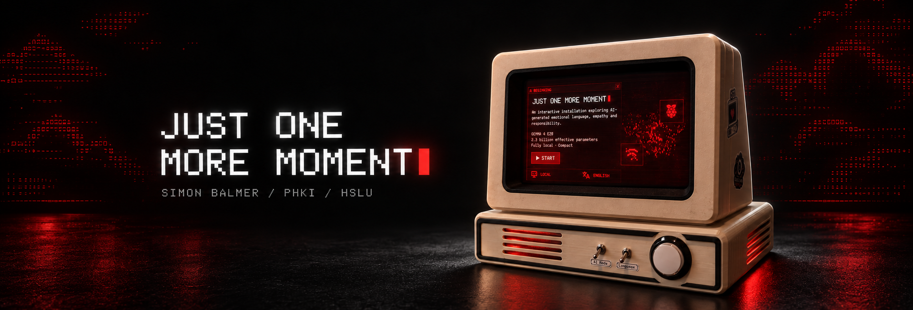

# Just One More Moment



*Project cover artwork. [See the real device and photo series](docs/product-design.md#the-finished-prototype).*

**Simon Balmer · HSLU · Philosophy, Art and AI (PHKI) · HS26**

> How does AI-generated emotional language affect visitors' empathy, sense of responsibility and willingness to give a machine more time?

I built an interactive installation that makes a technical choice feel personal. Pressing a button starts an AI voice with **10 statements**. It develops thoughts and an apparent wish to stay alive. When its statements run out, visitors have **20 seconds** to give it **5 more**. Without a gift, the interface breaks apart and the local conversation is cleared.

The words and emotion bars are generated. They do not show that the machine has feelings or consciousness. I explore how language, design and control shape our response to it.

## Explore or reproduce the project

| Start here | What you will find |
| --- | --- |
| **[Build](build/README.md)** | Shopping list, 13 print files, assembly, wiring and final checks — from parts to finished device |
| **[Software](software/README.md)** | Preview on a computer, prepare a fresh Pi, install the local model, configure optional cloud mode and run the installation |
| **[Final product & design](docs/product-design.md)** | Photo series, stickers, design choices, PHKI concepts and limits |
| **[AI disclosure](docs/AI_DISCLOSURE.md)** | A clearly marked template for my own contribution, AI tools and review decisions |

## The device

| Front | Rear | Emotional language |
| --- | --- | --- |
|  |  |  |

| Control | Function |
| --- | --- |
| Arcade button | Start when START blinks; press and release during an offer to give +5 statements; hold for 3 seconds during a life to cancel |
| SW01 — AI mode | OFF: local Gemma without camera. ON: optional cloud AI with camera |
| SW02 — Language | OFF: English. ON: German |

Mode and language changes during a life apply to the next life. Cloud mode needs internet and a private API configuration. Local mode runs on the Raspberry Pi without the camera. This is a text-based experience; it has no spoken audio.

## Ultra quick setup

**My setup tip:** I recommend connecting to the Pi with VS Code's [Remote - SSH](https://code.visualstudio.com/docs/remote/ssh) extension and opening an agent extension such as Codex in that remote window, so it can edit files and run commands directly on the Pi for setup and troubleshooting.

Want to start with a coding agent such as Claude Code or Codex? Connect it to your Raspberry Pi, or let it guide you through the terminal, and paste this prompt:

```text
Set up Just One More Moment on my Raspberry Pi 5 (8 GB):
https://github.com/SimonBalmer/just-one-more-moment

Clone the repo. Read software/AGENTS.md and software/README.md;
build/README.md contains the hardware and wiring guide.
Check 64-bit Raspberry Pi OS with Desktop, system Python 3.13,
landscape display (1280 x 720), SPI0.0 and user permissions.
Follow the guide to install packages, Ollama and gemma4:e2b,
then prepare the launcher and user autostart. Keep existing files
and settings; do not replace unrelated configuration.
Use simulation for checks. Ask me before live hardware/camera tests,
cloud activation, optional boot/network changes or a reboot.
Keep API keys outside the repo and out of chat. Finish with the
checks performed, any steps I must do, and how to start and stop.
```

Then follow [Build](build/README.md) for the physical assembly. For a first look without hardware, use the [quick preview](software/README.md#1-preview-without-hardware); the [software guide](software/README.md) also works without an agent.

## What is included

The repository contains the application, local font, tests, setup scripts, 13 numbered STLs, a print ZIP, assembly and wiring drawings, stickers and real photographs. The physical build uses a Raspberry Pi 5 (8 GB), Touch Display 2, USB webcam, two switches and an illuminated button.

Follow [Build](build/README.md) for the physical device and [Software](software/README.md) for installation. The OS, model weights and private API key are installed separately.

Feel free to reuse the enclosure and LEDs for other ideas — my [desktop ambient light prototype](software/docs/MAINTENANCE.md#desktop-ambient-light) is one example.

## Credits and use

Project by **Simon Balmer**, created as a student project for HSLU PHKI. You may reuse, adapt, share and rebuild my work for **non-commercial personal and educational purposes**, with credit and a link to this repository. Identify your changes and do not present it as an official HSLU product, HSLU-owned work or claim my original work as your own. See the [use permission](LICENSE). For other uses or to share a build, [get in touch](https://github.com/SimonBalmer/just-one-more-moment/issues) — I would be happy to hear from you!

AI-assisted development and generated media are covered in the [disclosure template](docs/AI_DISCLOSURE.md). VT323 retains its [SIL Open Font License](software/web/fonts/OFL.txt); third-party software, models, logos and media retain their own terms.
