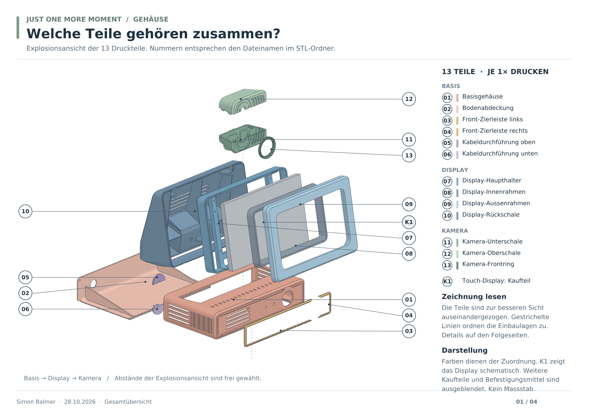
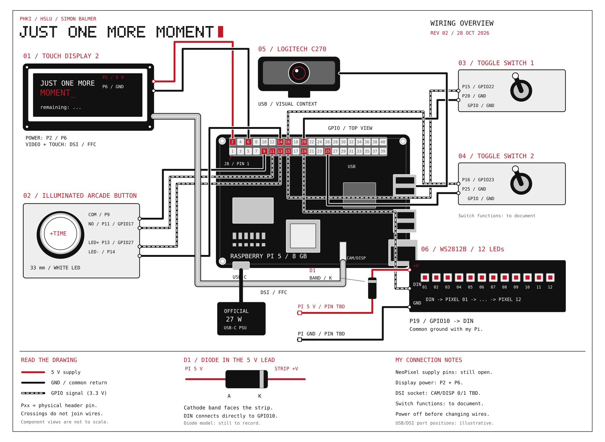
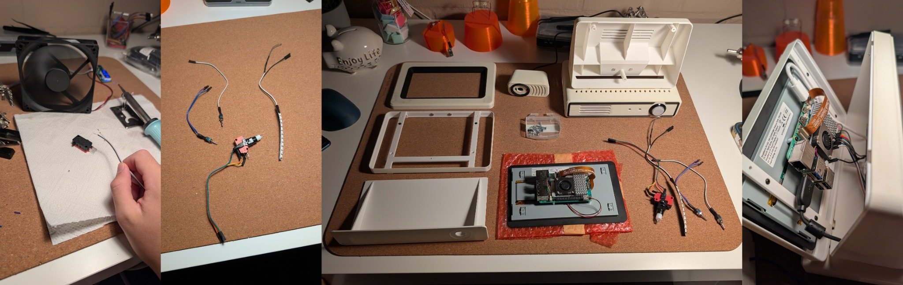

# Build the device

[Overview](../README.md) · [Software](../software/README.md) · [Product & design](../docs/product-design.md)

**Simon Balmer · HSLU PHKI HS26**

Follow these steps in order. I keep the parts list, printing, assembly and wiring on this page. Keep the covers open until the hardware and software checks pass.

## 1. Order and prepare

My [Galaxus shopping list — all linked parts](https://www.galaxus.ch/de/shopping-list/OdSpfGWFvwsEgOHc0J7WXnqzFrZIh4Vq) brings together all twelve shop products listed below. I bought these components there and am not affiliated with Galaxus; the links are simply for convenience. The table below is the full build list, including extra assembly materials. Check dimensions against the STLs before substituting parts.

| Part | Quantity | Specification / use |
| --- | --- | --- |
| [Raspberry Pi 5](https://www.galaxus.ch/de/s1/product/raspberry-pi-5-8gb-entwicklungsboard-kit-38955607) | 1 | **8 GB RAM** |
| [Pi 5 cooler](https://www.galaxus.ch/de/s1/product/raspberry-pi-official-fan-heat-sink-for-5-entwicklungsboard-zubehoer-38955610) | 1 | Official active cooler / compatible cooling assembly |
| [Raspberry Pi Touch Display 2](https://www.galaxus.ch/de/s1/product/raspberry-pi-official-touch-display-2-display-elektronikmodul-52316874) | 1 | **7-inch, SC1635**, 720 × 1280; mounted in landscape |
| Display cables and screws | 1 kit | Pi 5-compatible 22-way to 15-way DSI ribbon, power lead and mounting screws |
| [Logitech C270](https://www.galaxus.ch/de/s1/product/logitech-c270-090-mpx-webcam-5751463) | 1 | USB camera; case parts 11–13 are shaped for this camera |
| [microSD card](https://www.galaxus.ch/de/s1/product/sandisk-ultra-microsdxc-ssd-adapter-128-gb-microsdxc-u1-uhs-i-speicherkarte-22648088) | 1 | SanDisk Ultra 128 GB in my materials list; OS and model storage |
| [Pi 5 USB-C supply](https://www.galaxus.ch/de/s1/product/raspberry-pi-official-5-power-supply-27w-usb-c-entwicklungsboard-zubehoer-39631602) | 1 | Official 27 W supply |
| [Illuminated arcade button](https://www.galaxus.ch/de/s4/product/purecrea-arcade-taster-button-beleuchtet-33mm-weiss-schalter-taster-36705080) | 1 | Purecrea, 33 mm, white; separate switch and LED contacts |
| [Goobay subminiature toggle switch](https://www.galaxus.ch/de/s4/product/goobay-kippschalter-subminiatur-schalter-taster-14269955) | 2 | **Goobay 10013**, maintained ON/OFF, 2 solder terminals; SW01 mode, SW02 language |
| [WS2812B RGB NeoPixels](https://www.galaxus.ch/de/s1/product/purecrea-ws2812b-144ledm-led-neopixel-strip-69cm-entwicklungsboard-kit-39044922) | **11 LEDs** | Grouped `3 | 3 | 1 | 1 | 3` from DIN; self-adhesive strip |
| MIC 1N4001 diode | 1 | In the strip's 5 V supply lead |
| [Female jumper leads](https://www.galaxus.ch/de/s1/product/purecrea-jumperkabel-elektronikkabel-stecker-36133363) | As needed | 13 Pi-header connections; cut and solder the control ends as shown below |
| Heat-shrink tubing / insulation | As needed | Cover every exposed solder joint and diode lead |
| [PLA Matte, Ivory White](https://www.galaxus.ch/de/s1/product/bambu-lab-pla-matte-ivory-white-pla-1000-g-175-mm-filament-37002427) | As sliced | Light housings, frames and bracket; my listed filament is Bambu Lab 1.75 mm |
| [PLA Matte, Charcoal](https://www.galaxus.ch/de/s1/product/bambu-lab-pla-matte-charcoal-pla-1000-g-175-mm-filament-37002422) | As sliced | Dark trim, inner bezel, cable guide and camera ring |
| 2.9 × 9.5 mm screws | 3 | Sheet-metal/wood type, or a suitable equivalent; close display rear cover 10 |
| Suitable bolts/screws and nuts | 2 + 2 | Close base cover 02; choose diameter to fit printed holes |
| UHU Kraftkleber / suitable adhesive | As needed | Join rear cover 10 to base 01, trims and ring |
| Glue or tape | As needed | Secure camera inside shell 11 |
| Sticker paper | 1 A4 sheet | Optional [sticker PDF](../docs/assets/just-one-more-moment-sticker-card-a4.pdf) |

Tools: FDM printer and slicer, small screwdrivers, side cutters, wire stripper, soldering iron, solder, heat source for heat-shrink, multimeter, and a keyboard/mouse for Pi setup. Work on wiring with power disconnected.

## 2. Print the enclosure

[Download the print pack](../mechanical/enclosure-print-pack.zip) · [Individual STLs](../mechanical/stl/) · [Four-page assembly PDF](../mechanical/assembly/assembly-guide.pdf)

Print **one of each part, 01–13**. E1–E7 in the drawings are purchased components, not printable parts. Import in **millimetres at 100%**. The files retain assembly coordinates: centre and orient each part separately on the print bed.

| No. | Print file | Colour |
| --- | --- | --- |
| 01 | [Base housing](../mechanical/stl/01-base-housing.stl) | Ivory |
| 02 | [Bottom/rear cover](../mechanical/stl/02-base-bottom-cover.stl) | Ivory |
| 03 | [Front trim, left](../mechanical/stl/03-base-front-trim-left.stl) | Charcoal |
| 04 | [Front trim, right](../mechanical/stl/04-base-front-trim-right.stl) | Charcoal |
| 05 | [Rear cable guide, upper](../mechanical/stl/05-rear-cable-guide-upper.stl) | Charcoal |
| 06 | [Rear cable guide, lower](../mechanical/stl/06-rear-cable-guide-lower.stl) | Charcoal |
| 07 | [Display bracket](../mechanical/stl/07-display-main-bracket.stl) | Ivory |
| 08 | [Display inner bezel](../mechanical/stl/08-display-inner-bezel.stl) | Charcoal |
| 09 | [Display outer frame](../mechanical/stl/09-display-outer-frame.stl) | Ivory |
| 10 | [Display rear cover](../mechanical/stl/10-display-rear-cover.stl) | Ivory |
| 11 | [Camera lower shell](../mechanical/stl/11-camera-lower-shell.stl) | Ivory |
| 12 | [Camera upper shell](../mechanical/stl/12-camera-upper-shell.stl) | Ivory |
| 13 | [Camera lens ring](../mechanical/stl/13-camera-lens-ring.stl) | Charcoal |

Check the scale: part 01 has a CAD envelope of **125 × 225 × 50 mm**. The assembled printed enclosure is about **138 × 225 × 237.3 mm**. Left and right refer to the front view.

Use a calibrated PLA profile for your printer. Check support placement, openings and mating surfaces in the sliced preview. Keep supports off visible surfaces where possible. Remove support material and dry-fit the parts before gluing; check screw fit and cable clearance before final assembly.



## 3. Prepare the camera and base

1. Place the camera in lower shell **11**, lens facing the front. Its body reaches only to the middle divider. Secure it with glue or tape and lead the USB cable out at the rear.
2. Click **11** and **12** together. Gentle pressure on the sides of upper shell 12 helps the fit. Glue front ring **13** into place.
3. Glue trims **03/04** into the guides in base **01**.
4. Insert the arcade button from the front. Insert both switches from inside and secure them with their nuts: **SW01 left**, **SW02 right**.
5. Prepare the control wires: female ends go to the Pi header; cut, strip and solder the component ends. Cover each joint with heat-shrink.
6. Fix the NeoPixel strip under the inside ceiling of the base, so its light exits through the side vents. Identify **DIN** before attaching it. Keep all wiring accessible.

[Camera detail](../mechanical/assembly/camera-assembly.png) · [Base detail](../mechanical/assembly/base-assembly.png)

## 4. Assemble the display and Pi

1. Screw the Pi and cooler onto the back of the display using the display kit's mounting points and fixings.
2. With power disconnected, connect the display ribbon and power cable using the [official Touch Display 2 instructions](https://www.raspberrypi.com/documentation/accessories/touch-display-2.html). Use the Pi 5 ribbon and connect it to a CAM/DISP socket as shown in the official guide. Check display and touch operation before closing the case.
3. Attach the display/Pi unit to the four outer mounting points on bracket **07**. Fit inner bezel **08** into outer frame **09**, then clip the pair onto 07.
4. Glue rear cover **10** to base **01**. Let the adhesive cure before wiring.
5. Position the camera housing at the top of the display housing as shown in the overview. Route its USB lead to the Pi; keep the spare cable in the base.
6. Route the control wires, camera cable and power lead through the lower opening in 10. **Keep the front display unit and base cover open.**

[Display detail](../mechanical/assembly/display-assembly.png)

## 5. Wire the electronics

**Disconnect USB-C power first. All P-numbers below are physical pins; GPIO numbers are BCM. Never connect 5 V to a GPIO input.** Use the pin locator in the drawing, not the position of the functional Pi block, to locate the actual header pins.



[Printable A3 PDF](../hardware/diagrams/wiring-overview.pdf) · [PNG](../hardware/diagrams/wiring-overview.png)

| Lead | Pi physical pin | Function |
| --- | --- | --- |
| Display power + | **P2** | 5 V |
| Display power − | **P6** | GND |
| Button COM | **P9** | GND |
| Button NO | **P11** | GPIO17; NC stays unused |
| Button LED+ | **P13** | GPIO27, 3.3 V output |
| Button LED− | **P14** | GND |
| Strip DIN | **P19** | GPIO10 / SPI0 MOSI |
| Strip +V | **P4 → diode → +V** | 5 V through MIC 1N4001 |
| Strip GND | **P34** | Common GND |
| SW01 signal | **P15** | GPIO22 |
| SW01 return | **P20** | GND |
| SW02 signal | **P16** | GPIO23 |
| SW02 return | **P25** | GND |
| Camera | USB | Connect C270 to a USB port |
| Display ribbon | CAM/DISP | Video and touch, separate from header power |

**Diode direction:** P4 connects to the **unbanded anode**. The **banded cathode** points towards strip **+V**. P34 connects directly to strip GND; P19 connects directly to DIN. The diode is in the power lead, not the data lead.

This follows the [Adafruit diode method](https://learn.adafruit.com/neopixels-on-raspberry-pi/raspberry-pi-wiring): reducing strip supply voltage helps it recognise 3.3 V data. It is not an active level shifter. The diode must carry the strip's current; this project uses low brightness. Do not drive a full strip at unrestricted brightness from this arrangement.

The direct GPIO connection for the button light applies to my **internally current-limited Purecrea button LED**. The earlier hardware record reports at most 0.6 mA at 3.3 V. A replacement LED needs its own current-limit/driver check; an ordinary bare LED cannot use this wiring unchanged.

Both selector inputs use internal pull-ups. **Closed to GND / LOW = OFF; open / HIGH = ON.** Use a multimeter to choose the correct contacts and mount the switches so the labels match. SW01 selects software mode; it does not disconnect USB power. GPIO8 / CS0 is not connected to the strip.



*Assembly sequence: soldering the contacts, prepared wiring, parts before assembly, and Pi behind the display.*

## 6. Install and check before closing

1. Inspect every header connection against the table. Check diode direction, strip DIN and insulated joints. Keep cables clear of the cooler, mounting holes and vents.
2. Follow the **[software setup from a fresh Pi](../software/README.md#2-prepare-a-fresh-raspberry-pi)**, including SPI and user permissions.
3. With the main application stopped, run from `software/`:

   ```bash
   python3 check_hardware.py --stage inputs --seconds 30
   python3 check_hardware.py --stage led
   python3 check_hardware.py --stage pixels
   ```

   These are real hardware tests. Confirm the button, both switch positions, button light and all **11 addressed pixels**. The pixel test uses dim colours and a moving light. Ctrl+C closes the outputs.
4. Start the application and check the display in landscape, blinking START, local mode, both languages, +5 offer and 3-second cancellation. Check camera/cloud separately only after configuring it and explaining image use to anyone in view.
5. Exit with Escape and shut down the Pi from the desktop before disconnecting power.

## 7. Close and finish

1. Disconnect power. Fit the front screen unit onto **10** and secure it with the three **2.9 × 9.5 mm** screws or suitable equivalents. Do not trap wires or overtighten into printed plastic.
2. Loosely coil the spare USB cable inside the base. Lead the Pi power cable out through **02**.
3. Fit **05 above 06 on the outside of 02**, around the outgoing power lead. Secure the guide so the cable cannot pull on the Pi connector.
4. Close cover **02** last, using two suitable screws/bolts and matching nuts.
5. Apply the [stickers](../docs/assets/just-one-more-moment-sticker-card-a4.pdf), reconnect power and repeat the short display/control check.

## Files and build settings

The print files use millimetres and one part per STL. Printer orientation, supports and screw fit depend on the printer and material, so check the sliced preview and dry-fit the parts. Choose base fasteners that fit the printed holes and trim the wire lengths to your cable routing. Keep the cooler and vents clear.

The final build uses **11 NeoPixels**, matching the software and drawings. [hardware_pins.py](../software/hardware_pins.py) contains the pin assignment and pixel count.

STLs keep their original geometry. Part 10 had four opposite duplicate facets removed in the first print release; its [original export](../mechanical/source/10-display-rear-cover-original.stl) is retained. The [parts manifest](../mechanical/parts-manifest.json) records names, dimensions and hashes. Mesh checks do not replace checking sliced supports and physical fit.

Drawing sources are included: [wiring generator](../hardware/diagrams/generate_wiring.py) and [assembly generator](../mechanical/assembly/generate_assembly.py). They are optional documentation tools, not runtime dependencies. Regeneration requires Python with `reportlab`, `fonttools`, `numpy`, `Pillow`, `PyMuPDF` and Poppler's `pdftoppm`. Set `JOMM_MONO_FONT` and `JOMM_MONO_BOLD_FONT` to compatible TrueType font paths, then run the generators from the repository root. Pre-rendered files are supplied so builders do not need these tools.
