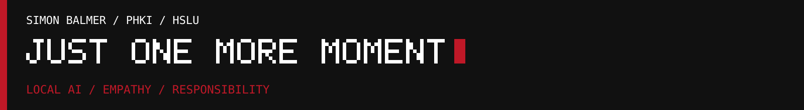

# AI disclosure

**Simon Balmer · Just One More Moment · HSLU PHKI HS26**

**Template — I will complete and review this before submission.** The confirmed uses below are a starting point, not a complete declaration of my development process.

## My contribution

I am responsible for the final project and every submitted claim. I will describe which parts I made independently, which decisions I made, and how I checked AI-assisted work.

| Area | What I made or decided myself | Evidence |
| --- | --- | --- |
| Project question and philosophical position | [Complete in my own words] | [Brief / notes] |
| Enclosure, printing and physical assembly | [State my independent work and any assistance] | [CAD / build photos] |
| Interaction, interface and visual design | [State my decisions and what I changed] | [Versions / photos] |
| Testing, interpretation and reflection | [Describe what I personally tested or observed] | [Test notes / reflection] |

## AI tools and their influence

| Tool / model and date | What it was used for | Influence on the final work / my review |
| --- | --- | --- |
| Ollama / `gemma4:e2b` | Live text and emotion labels in local mode | The dialogue is generated during use. I set the prompts and interaction rules. [Review / extend] |
| OpenAI Responses API / [actual model used] | Live text and emotion labels using fresh camera images in cloud mode | [Record the actual configuration, selection and review] |
| OpenAI Codex / [model, dates] | Assistance with code and repository documentation | [Describe scope, accepted changes, corrections and tests] |
| [Image generation / editing tool, model and date] | Project cover artwork | [Record source photographs, image edits and my review of the supplied cover] |
| [Other tool, model and date, if used] | [Purpose] | [Influence and review] |

## Decisions and process evidence

- **Accepted:** [One output I kept, and why.]
- **Changed:** [One output I revised, what I changed, and why.]
- **Rejected:** [One output I rejected, and why.]
- **Checks and limits:** [How I checked the result and what remains uncertain.]

The [prompt notes](../software/docs/PROMPTS.md) explain the current design. Earlier prompt versions and the cloud comparison remain in the [development archive in Git history](https://github.com/SimonBalmer/just-one-more-moment/tree/b98c5406c81a261ddac57efb7e0c18094be5c5c8/software/docs) as process evidence. They do not establish which work I made without AI; I must state that accurately above.

## Cover image record

Asset: [project-banner.png](../media/project-banner.png), copied unchanged from my supplied `Main_Project_Photo_Banner.png`.

- **Source photograph / artwork:** [Complete]
- **AI tools and edits, if used:** [Complete]
- **My selection and changes:** [Complete]

The cover is presented as artwork. The separate photo series documents the physical prototype.

**Final review by Simon Balmer:** [Date]
