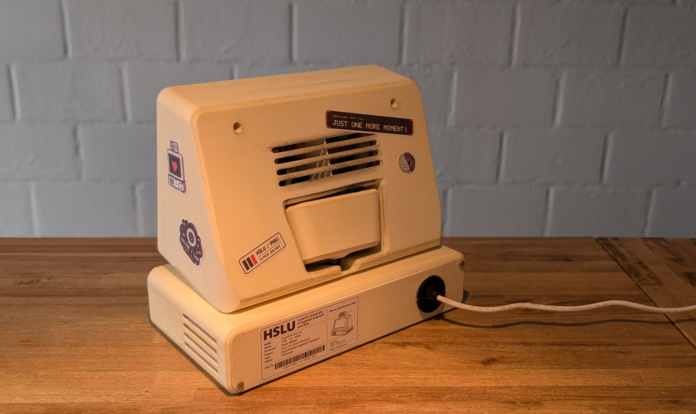
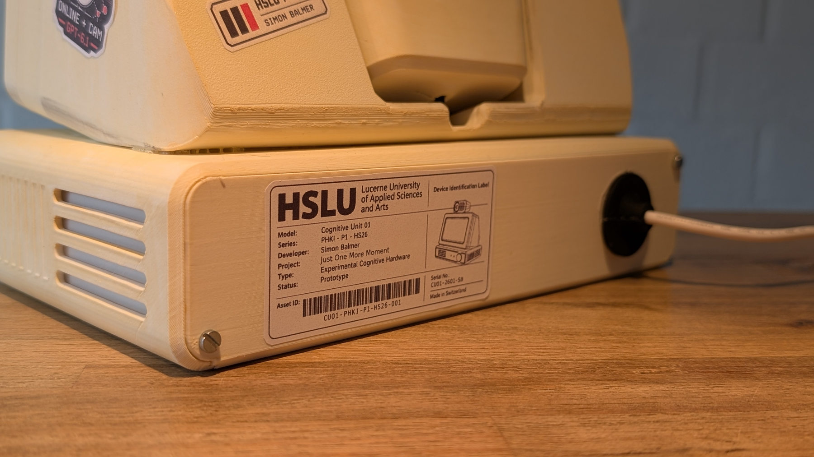
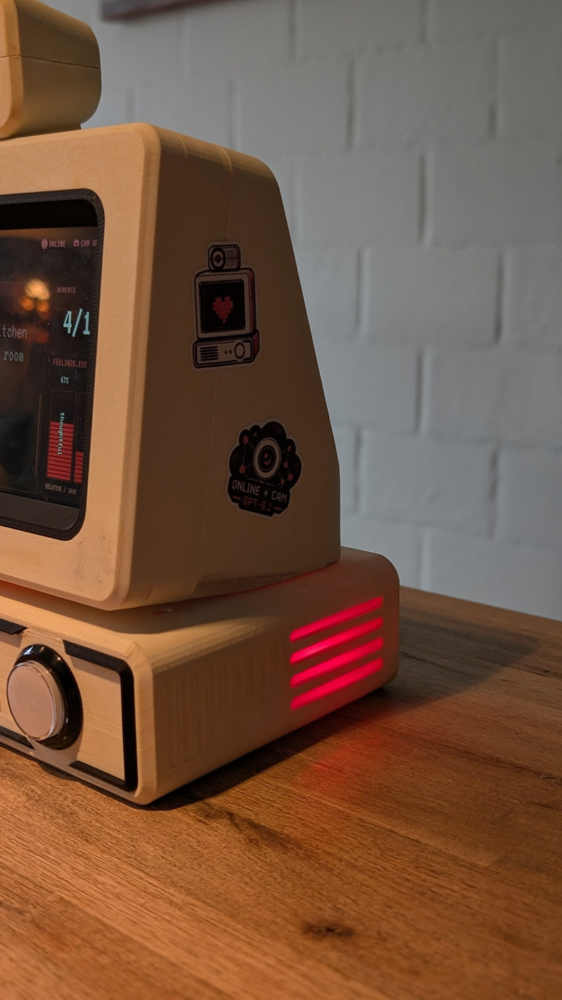

# Final product & design

[Overview](../README.md) · [Build](../build/README.md) · [Software](../software/README.md) · [AI disclosure](AI_DISCLOSURE.md)

**Simon Balmer · HSLU PHKI HS26 · 2026**

## My question

> How does AI-generated emotional language affect visitors' empathy, sense of responsibility and willingness to give a machine more time?

I am exploring how **AI-generated emotional language** changes **empathy and the sense of responsibility** for **people interacting with a device that appears to have feelings**, and I want my audience to notice **how a simple technical decision can feel like a moral choice, even when the machine may not actually feel anything**.

This raises a broader philosophical question: **How can we recognize or measure genuine consciousness, and how would we know if an AI truly experiences anything**?

I built a small physical installation to let people experience this question. A visitor starts an AI voice with ten statements. When these run out, the visitor can give it five more or let it end. There is no typed conversation or microphone input. The tension comes from having control over something that speaks as if it wants to stay alive.

The final version uses a **statement budget** and two modes: **Local AI** and **Cloud AI + Cam**. Both use emotional language. I focus on the visitor’s choice to give the voice more time and the responsibility that this choice can seem to carry.

## The finished prototype

These are real project photographs. Screen text in the photographs is generated by AI.

| Front | Three-quarter view |
| --- | --- |
|  |  |

| Generated language | Physical choice |
| --- | --- |
|  |  |

| Rear enclosure | Labels and power | Light through the vent |
| --- | --- | --- |
|  |  |  |

## Why I made it look this way

I use an ivory case, black trim, a large button, pixel lettering and red light to give the object a familiar retro character. I want it to feel like a specific object with a history, rather than an invisible service. The camera housing echoes the screen housing. The vents reveal light from inside without exposing the electronics.

The interface uses black, white and red, the locally included VT323 font, simple windows and moving ASCII characters. The main text stays large. The statement counter makes the limit visible. The “feelings” bars are values generated by the model and scaled to relative shares; they are **not measurements of actual feelings**. Breathing light, typing and the final breakup make the software state physically visible.

I designed the animation and the light inside the base as the instance's **imaginary soul and life energy**: it forms on screen, slides down into the enclosure and seems to live there through the breathing red light. At the end, the screen breaks apart and the light goes out. These are deliberate design choices that give the instance a physical presence and make its ending visible.

## Stickers and labels

[Download my A4 sticker sheet](assets/just-one-more-moment-sticker-card-a4.pdf).

The warning-style “May evoke empathy” sticker makes the emotional framing visible before the device speaks. Small labels identify the two selectors. The HSLU and author label gives the object a clear project context. I use the stickers as part of the object's apparent personality and as practical orientation for visitors.

For a new build, print the PDF at **100% / actual size**, check the fit against the enclosure, cut the labels and apply them after assembly. Colours in print can differ from the screen.

## The PHKI connection

**Anthropomorphism** means giving human feelings or intentions to something non-human. I use it through the device's language, apparent fear, light and familiar shape. A visitor may care about it while knowing its words are generated. The project asks whether empathy depends only on the other side's inner experience, or also on our interpretation.

**Agency and power** are split between several actors. Visitors decide whether to offer another moment. I decide the available choices, the budget and the emotional arc. The model supplies the words within those conditions. In cloud mode, the provider also controls access and model behaviour. The visitor's choice is therefore shaped by decisions made before the interaction starts.

**Authenticity and responsibility** remain open questions. First-person language and convincing fear are not evidence of consciousness. I am responsible for deliberately staging that fear, explaining the camera and cloud mode, and making the generated nature of the encounter clear.

| Perspective | What matters | Control and tension |
| --- | --- | --- |
| Visitor | Curiosity, empathy and freedom to leave | Can start, extend or end the encounter; emotional language may feel like pressure |
| Me as designer | A clear question and a convincing experience | I shape the apparent personality and limits, so I also shape the pressure |

## What the project can and cannot show

I have shown the installation to several people of different ages and recorded some of their reactions. Their responses were mostly similar: they were surprised by how alive, emotionally convincing and thoughtful such a technical system could seem. A recurring question was why it sounded so human, as if it could feel.

In **Cloud AI + Cam mode**, what stood out to me was the voice's apparent understanding of its surroundings and the way it seemed to form and develop thoughts of its own. The camera gives the model visual context for its statements. This impression often led people to question the topic through the encounter itself. It is part of the experience I designed, rather than evidence of an inner life.

A button press alone is **not a reliable measure of someone's sense of responsibility**. It records an action, but does not explain why someone chose it. For me, the more important response comes after watching a life: the questions people ask themselves.

- What does this experience do to me?
- Did I just feel something like empathy?
- Am I aware that this encounter is produced by a technical, computational process?
- Do I still feel responsibility, guilt or empathy, even knowing how it works?

Most of the people I showed it to raised or answered questions like these themselves after watching. **Their reactions suggest to me that the project has achieved its artistic goal:** making these questions tangible and encouraging people to examine their own response to AI.

These are informal observations, not a controlled study or a measurement of empathy. They do not establish machine consciousness. The two modes also differ in model and visual input, so differences between them cannot be attributed to language alone. Generated statements can still repeat, invent details or miss the intended emotional arc.

My [AI disclosure](AI_DISCLOSURE.md) separates my own contribution from AI assistance. The [prompt notes](../software/docs/PROMPTS.md) explain the design of the generated voice.
